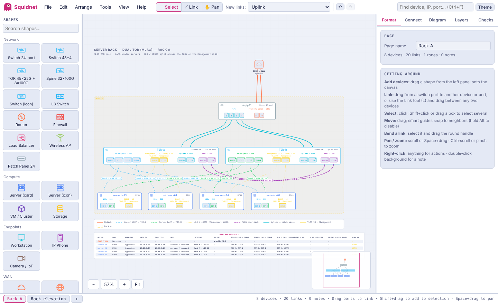
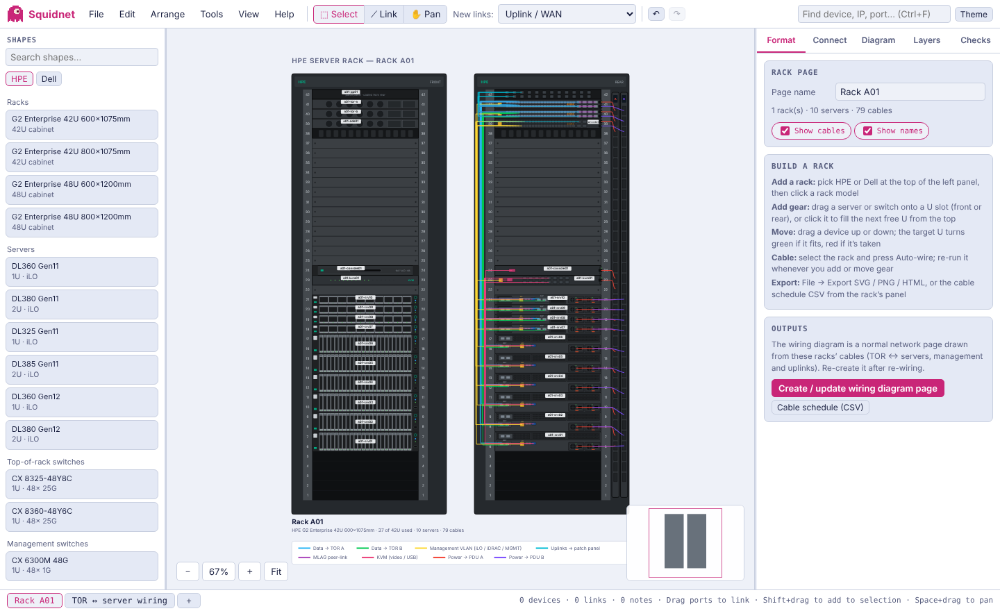

<h1 align="center">Squidnet</h1>

<b>A free, offline network diagram builder in a single HTML file.</b> 
Spine/leaf and TOR templates · HPE &amp; Dell rack elevations with auto-wiring · VLANs &amp; port maps · Visio (.vsdx) import/export

<a href="https://dsaleeb.github.io/squidnet/"><b>▶ Open Squidnet in your browser</b></a>

---

Squidnet runs entirely in your browser. There's nothing to install, no server, and your diagrams never leave your computer.

## Getting started

- **Online:** open **https://dsaleeb.github.io/squidnet/**
- **Offline:** download [`Squidnet.html`](Squidnet.html) and double-click it. It works with no internet connection.

Start from **File → New from template**, or drag shapes from the left panel onto the canvas.

## Features

**Network diagrams**
- Drag-and-drop devices with real port panels; drag from a port to create a link
- Link types, VLANs (trunk / access / native), LACP bonds, speeds and labels
- Zones, notes, layers, smart guides, auto layout, undo/redo, multiple pages
- Checks for duplicate ports, VLAN mismatches and unconnected devices
- Port map table, cable list and bill of materials reports

**Templates**
- Server rack — dual TOR (MLAG), with an optional out-of-band management switch
- Server rack — HPE and Dell (front & rear), with optional KVM monitor and KVM switch
- Single TOR cluster, spine/leaf fabric, campus core/access, branch office, hub-and-spoke WAN, DMZ, dual-fabric SAN, hybrid cloud

**Rack elevations**
- HPE G2 Enterprise and Dell PowerEdge 42U/48U racks, shown front and rear
- HPE ProLiant DL360/DL380/DL325/DL385 Gen11–12 and Dell PowerEdge R660/R760/R6625/R7625/R670/R770 servers
- Aruba CX and Dell PowerSwitch TOR and management switches, patch panels, 0U PDUs, KVM gear
- Servers stack from the bottom (U6 up); networking runs on the left, power on the right
- **Auto-wiring:** data to TOR A/B, iLO/iDRAC (management switch or a Management VLAN on the TORs), MLAG peer-link, uplinks, KVM and power A/B
- Generates and updates a TOR ↔ server wiring diagram from the rack, and exports a cable schedule (CSV)

**Visio and other formats**
- View and import Visio `.vsdx` files, including stencil pictures, themes and embedded objects
- Export to Visio (`.vsdx`), draw.io, SVG, PNG, PDF and a self-contained HTML viewer
- Import devices and links from CSV or LLDP neighbour output

## Your data

Your work autosaves in the browser. To keep a diagram safely or share it, use **File → Save project (.json)** and open it again with **File → Open**.

## Author

Created by **Dan Saleeb** — [github.com/dsaleeb](https://github.com/dsaleeb)

© 2026 Dan Saleeb. All rights reserved. See [THIRD-PARTY-NOTICES.md](THIRD-PARTY-NOTICES.md) for third-party components.
